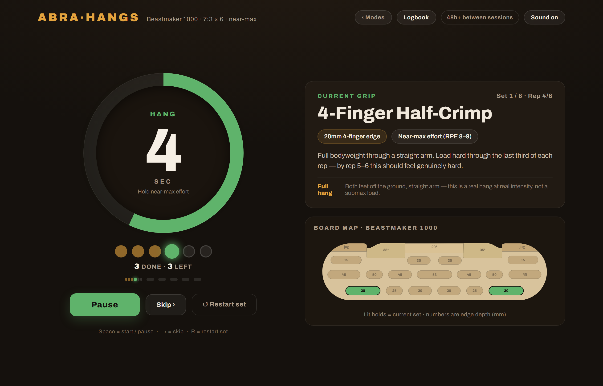

# Abra·Hangs — hangboard timer

A hangboard training timer that runs in the browser. It has no install, no account and no backend, and your sessions are kept in your browser's local storage.

**▶ Open it: https://wldevries.github.io/beast-routines/**



## Modes

- **Abrahangs**: 10 minutes of low-intensity, feet-on-the-floor loading, done twice a day. Each set cycles through a different grip.
- **Repeaters**: near-max full hangs (e.g. 7s on / 3s off × 6 reps). You pick 1–2 holds and choose a preset or set your own hang, rest, reps, sets and added weight.

## Supported boards

- **Beastmaker 1000**
- **Simond Ballsy Board**

Pick your board on the home screen. Each board keeps its own hold choices and Repeaters setup.

## Features

- A board map that lights up the holds for the current set.
- Big rep pips showing how many reps of the current set are done and left.
- **Restart set**, for when you weren't on the board in time.
- Audio cues for the countdown, hang start and rest.
- A **Logbook** of finished sessions, including how many reps you actually managed in each Repeaters set.
- Keyboard shortcuts: `Space` start/pause · `→` skip · `R` restart set.

## Development

The app is plain HTML/CSS/JS in [`site/`](site/), with no build step. Node is only used for serving it locally and for the tests.

```sh
npm install
npx playwright install chromium   # first time only

npm start            # serve site/ at http://localhost:8000
npm test             # Playwright browser tests (fake clock, ~5s)
npm run test:ui      # step through the tests interactively
npm run screenshot   # regenerate docs/screenshot.png
```

Every push and pull request runs the tests through GitHub Actions. Pushes to `main` that pass are deployed to GitHub Pages; only the `site/` folder is published.
